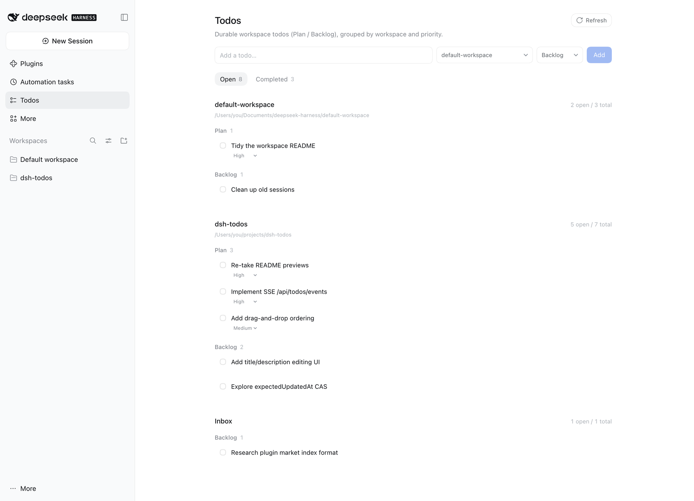

# dsh-todos

[](https://www.npmjs.com/package/dsh-plugin-todos)
[](https://www.npmjs.com/package/dsh-plugin-todos)
[](https://github.com/zhihuz123/dsh-todos/actions/workflows/ci.yml)

**Durable workspace todos for DeepSeek Harness.**

English | [中文](README.md)

Keep *how this turn is executed* in the session. Keep *what to do next* in the workspace.

`dsh-todos` solves the cross-session todo problem: follow-ups discovered by an Agent during a conversation, next steps you have explicitly committed to, and ideas you are not acting on yet can all live in a workspace's Plan / Backlog — still there tomorrow, in the next session, and after a Host restart.

> Early-stage project (`0.2.0`), verified on Desktop `0.2.2-rc.1` / macOS.  
> Repository: `dsh-todos`; install package: `dsh-plugin-todos` (`dsh-todos` is already taken on npm).



---

## Why

DSH's built-in `todo_write` is the execution checklist for **the current turn**: it answers "how are we doing this now" and is cleared on `turn/start`. It is not responsible for "what should we do tomorrow".

`dsh-todos` fills in the other two layers:

```text
Session todo_write   How this turn is executed (current turn, temporary)
Workspace Plan       Already decided to do next (durable, explicitly committed)
Workspace Backlog    Worth doing later (durable, not committed)
```

The three layers are **deliberately not synchronized**. Two sources of truth chasing each other will eventually disagree.

## Features

- **Open / Completed tabs**: Open is split into Plan / Backlog; Completed is grouped by workspace and sorted by completion time.
- **Plan / Backlog**: Plan holds committed next steps; Backlog holds discovered work that is not being started now.
- **Workspace-level persistence**: independent of any one session and survives a Host restart.
- **Three write paths**: Overview UI, the `todo_add` / `todo_update` Agent tools, and the `/todo` command.
- **Plan priority**: high / medium / low, default high; Plan lists sort by priority → order.
- **Complete, restore, clear**: completion changes state, never deletes; items can be restored; completed items can be permanently cleared per workspace.
- **Provenance**: Agent-created items record `sourceSessionId` and can open the source session.
- **No new auth layer**: HTTP routes use DSH Connection's owner Peer, cookie, and Host/Origin fence.
- **Visibility-aware polling**: 4.5s while the Overview is mounted and the page is visible; stops when hidden; refreshes on focus/visibility and after mutations.

## Install

Requires DSH `>= 0.2.1-rc.1 < 0.3.0` (`engines.dsh`); verified on Desktop `0.2.2-rc.1` (macOS).

### Web profile

```bash
dsh plugin --profile web add dsh-plugin-todos
```

Refresh DSH Web and the **Todos** panel appears in the sidebar. You can enable/disable it later under **Settings → Plugins**.

### Desktop

**Option A (recommended, Desktop stays open)**: sidebar **Plugins → Add plugin**, enter `dsh-plugin-todos`. The Host reads the manifest first, confirms it is a bundle, installs it, and enables it; refresh the page.

**Option B (fully quit Desktop first)**:

```bash
"/Applications/DeepSeek Harness.app/Contents/Resources/runtime/cli/bin/dsh" \
  plugin --profile desktop add dsh-plugin-todos
```

The desktop profile is owned by Electron; use Desktop's bundled CLI (with `manageDesktopProfile` and its own pnpm), not a global npm `dsh`. The install records the dependency in `~/.dsh/profiles/desktop/package.json` and selects the bundle in `dsh.profile.bundles`; reopen Desktop to load it.

### From source (development)

```bash
git clone git@github.com:zhihuz123/dsh-todos.git
cd dsh-todos
npm install
npm run build
dsh plugin --profile web add "file:$PWD"
```

A `file:` dependency is hard-linked: `npm run build` rewrites `lib/*.js` in place, so the profile copy follows; HMR reloads the host half and a page refresh loads the client half. Desktop accepts the same `file:` spec for a local checkout.

Compatibility: `engines.dsh` decides whether an install is allowed, so no version exemption is needed; `peerDependencies` are declarative and pnpm may print missing-peer warnings — those packages are provided by the DSH runtime, not a failure. On Desktop, installation, bundle selection, panel rendering, and the composer were verified; the full mutate flow and `/todo` commands have not been smoke-tested item by item.

### Development

```bash
npm install
npm run build
npm test
```

- Host changes: toggle the plugin off/on in Settings, or restart `dsh web`;
- Client changes: `client-hmr` pushes a new bundle; refresh the page;
- On Desktop, refresh the page after client changes; restart the app if that does not pick them up.

## Usage

### Overview

The composer supports:

```text
[ Title ] [ Space: Workspace / Inbox ] [ Bucket: Plan / Backlog ] [ Add ]
```

- A manually created Plan defaults to **high**; change it with the priority select on the item afterwards;
- Inbox only holds Backlog;
- Plan lists sort by priority → order; changing priority reorders the list.

### `/todo` command

Type it in a session. It does not go through the model and does not start a new turn:

```text
/todo <text>              → Backlog
/todo add <text>          → Backlog (escape for titles starting with plan/backlog)
/todo backlog <text>      → Backlog
/todo plan <text>         → Plan (defaults to high)
```

Examples:

```text
/todo Fix authentication bug
/todo plan Implement SSE
/todo backlog Investigate flaky test
/todo add plan the migration
```

The result appears as a command card in the conversation. It only records the item; it does **not** make the Agent start working. Send a follow-up message if you want action.

`/todo plan` in Inbox returns an error instead of silently downgrading.

### Agent tools

```text
todo_add({ title, bucket?, description?, priority? })
todo_update({ id, status?, bucket?, title?, description?, priority? })
```

`todo_add` does not accept `workspaceId`: the Host resolves it from the current session's workspace membership → parent session → longest cwd prefix → Inbox.

Agent write rules are enforced by the system prompt and tool descriptions:

- Autonomous discoveries default to **Backlog**: concrete, actionable, outside the current task, or follow-up work that will not be completed now;
- **Plan only on explicit user commitment**: "add this to plan", "we'll do next", "make it a plan";
- A plan the Agent proposes is not a commitment; wait for user confirmation;
- Do not record current execution steps, speculative improvements, minor observations, completed work, duplicate items, facts, or preferences;
- "Remember this" only becomes a todo when it is **actionable work**.

### Completion and cleanup

```text
pending / in_progress
        │ complete
        ▼
    completed ── restore ──▶ pending
        │
        ├─ delete           permanent single-item delete
        └─ clear completed  permanent per-workspace bulk delete
```

There is no `archived` state. Completed is the history; clearing is deletion.

## Architecture

```text
Overview UI ── fetch /api/todos* ──┐
                                   ├── Connection Fetch (Harness auth + Host/Origin fence)
Agent ── todo_add / todo_update ───┤
User  ── /todo command ────────────┤
                                   ▼
                              TodoService
                                   │
                          storageDomain: workspace_todos
                                   │
                              todos table
```

- **Auth is not implemented by this plugin**: routes are registered on `ctx.connection.fetch`; only the owner Peer can reach them. Cookies, Host/Origin, and CSRF are handled by Connection. There is no plugin token.
- **storageDomain is the single source of truth**: durable writes, synchronous reads, one write chain.
- **Exact routes support GET/HEAD/POST only**, so every mutation is a POST.
- The Overview polls only while mounted and visible; hiding the page stops polling, focus/visibilitychange refresh immediately.

### Data model

```ts
type Scope =
  | { type: 'workspace'; workspaceId: string }  // stable UUID
  | { type: 'inbox' }                            // explicit, never null

interface Todo {
  id: string
  scope: Scope
  bucket: 'plan' | 'backlog'
  title: string
  description?: string
  status: 'pending' | 'in_progress' | 'completed'
  priority?: 'low' | 'medium' | 'high'  // required for Plan; absent on Backlog
  order: number                         // manual order within a priority
  sourceSessionId?: string
  createdBy: 'user' | 'agent' | 'system'
  createdAt: number
  updatedAt: number
  completedAt?: number
}
```

### HTTP API

Everything lives under `/api/todos` and uses one envelope:

```json
{ "ok": true, "value": { "todos": [] } }
{ "ok": false, "error": { "code": "todo/not-found", "message": "..." } }
```

| Method | Path | Description |
| --- | --- | --- |
| GET | `/api/todos` | List all workspace todos |
| POST | `/api/todos/create` | `{ scope, bucket?, title, description?, priority? }` |
| POST | `/api/todos/update` | `{ id, ...patch }` (status/bucket/title/description/priority) |
| POST | `/api/todos/clear-completed` | `{ scope }`; permanently deletes completed items in that workspace/Inbox; returns `{ deleted }` |
| POST | `/api/todos/delete` | `{ id }` |

No cookie → 401; wrong Origin → 403. Both come from Connection, not this plugin.

### Priority and Inbox

- **Plan** always has a priority: `high | medium | low`, default **high**;
- **Backlog** has none; a supplied priority is ignored, and Plan → Backlog clears it;
- **Backlog → Plan** sets **medium** (an explicit priority wins);
- **Inbox** is Backlog-only; an Agent request for `plan` in a session without a workspace is downgraded and returns `downgraded: true`;
- **Plan order** is priority (high → medium → low) → `order`; Backlog uses `order`; the API and Overview use the same order.

## Known limitations

- Session `todo_write` is deliberately not synchronized.
- No SSE; polling is 4.5s while visible, plus focus/visibility/mutation refreshes.
- Single-user / single-Host semantics; concurrent edits use last-writer-wins, with no CAS.
- After a workspace is deleted, stored todos are kept and shown as "Removed workspace"; they are not moved to Inbox.
- No drag-and-drop ordering and no title-editing UI (`todo_update` supports it).
- Desktop verification covers installation, bundle selection, panel rendering, and the composer; the full mutate flow and `/todo` commands have not been smoke-tested item by item.
- Targets the DSH `0.2.1-rc.x` API surface and is verified on `0.2.2-rc.1`; re-verify `connection.fetch`, `storageDomain`, `workspaceRegistry`, `tools`, and `commands` before upgrading DSH.

## Roadmap

- [x] Desktop install notes and npm publishing (`dsh-plugin-todos@0.2.0`)
- [ ] Full Desktop interaction smoke test: mutate, restore, clear, and `/todo` commands
- [ ] SSE `/api/todos/events` with snapshot + revision and polling fallback
- [ ] Drag-and-drop ordering
- [ ] `expectedUpdatedAt` CAS
- [ ] Title/description editing UI
- [ ] Completed-item provenance and statistics

## Development

```bash
npm install
npm run build     # src/host -> lib/index.js; src/client -> lib/client.js
npm test          # schema/service/tools/routes/commands + derive + store + bundle SSR
```

```text
src/host/
  schema.js        zod schema + defineDomain('workspace_todos')
  service.js       TodoStore: list/create/update/delete/validate/order
  scope.js         session → workspace/inbox resolution
  routes.js        Connection Fetch exact routes
  tools.js         todo_add / todo_update
  commands.js      /todo parsing and Host handler
  guidance.js      three-layer system prompt
  index.js         Cordis service / tools / routes / commands wiring
src/client/
  api.js           /api/todos fetch client
  workspace-store.js  visibility polling; forced refresh after mutations
  derive.js        workspace grouping / current workspace
  index.jsx        Overview, composer, Plan/Backlog, completed
  styles.js        design-token styles
test/
  host.test.mjs
  workspace-store.test.mjs
  derive.test.mjs
  render.test.mjs
```

## License

MIT. See [LICENSE](LICENSE).
