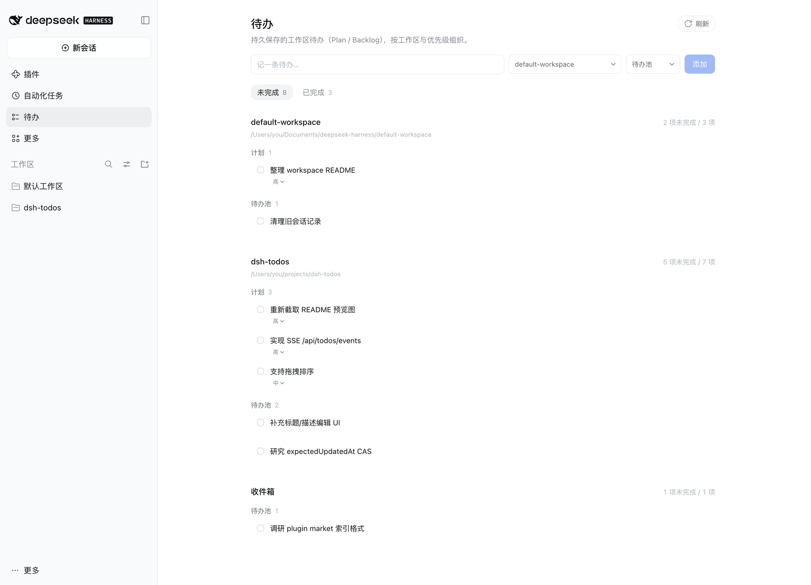

# dsh-todos

**DeepSeek Harness 的持久工作区待办面板。**

把「这次怎么做」留在会话里，把「接下来做什么」留在工作区。

[English](README.en.md) | 中文


`dsh-todos` 解决的是跨会话的待办问题：Agent 在会话里发现的后续工作、你明确承诺的下一步、暂时不做的想法，都可以落到 workspace 的 Plan / Backlog 里，第二天、下一个会话、甚至重启 Host 之后仍然在。

> 早期版本（`0.2.0`），已在 Desktop `0.2.2-rc.1` / macOS 上验证。  
> 仓库名是 `dsh-todos`，安装用的包名是 `dsh-plugin-todos`（npm 上的 `dsh-todos` 已被占用）。

[](https://www.npmjs.com/package/dsh-plugin-todos)
[](https://www.npmjs.com/package/dsh-plugin-todos)

[](https://github.com/zhihuz123/dsh-todos/actions/workflows/ci.yml)



---

## 为什么需要它

DSH 官方的 `todo_write` 是**当前这一轮**的执行清单：它回答“这次怎么做”，`turn/start` 时清空。它不负责“明天还要做什么”。

`dsh-todos` 补的是另外两层：

```text
Session todo_write   这次怎么做（当前轮，临时）
Workspace Plan       已经决定接下来做什么（持久，用户明确承诺）
Workspace Backlog    值得以后做什么（持久，暂未承诺）
```

三者**不自动同步**。这是有意设计：两套 source of truth 互相追赶，最后一定有一边失真。

## 功能

- **未完成 / 已完成两个 tab**：未完成分 Plan / Backlog；已完成按 workspace 分组，按完成时间倒序。
- **Plan / Backlog**：Plan 是已承诺的下一步，Backlog 是发现但暂不执行的。
- **Workspace 级持久化**：不依赖某个会话是否还开着，Host 重启后仍在。
- **三种写入方式**：Overview UI、Agent 的 `todo_add` / `todo_update`、`/todo` 命令。
- **Plan 优先级**：high / medium / low，默认 high；Plan 列表按 priority → order 排序。
- **完成、恢复、清理**：完成只写状态，不删除；可恢复；可按 workspace 永久清理已完成。
- **来源可追溯**：Agent 写入时记录 `sourceSessionId`，可从条目打开来源会话。
- **不新增鉴权**：HTTP 路由走 DSH Connection 的 owner Peer、cookie 和 Host/Origin fence。
- **可见时才轮询**：Overview 挂载且页面可见时 4.5s 一次；hidden 停止；focus/visibility 立即刷新。

## 安装

要求 DSH `>= 0.2.1-rc.1 < 0.3.0`（`engines.dsh`）；已在 Desktop `0.2.2-rc.1`（macOS）上验证。

### Web profile

```bash
dsh plugin --profile web add dsh-plugin-todos
```

刷新 DSH Web，侧边栏会出现「待办」；之后可在 **设置 → 插件** 里启停。

### Desktop

**方式 A（推荐，无需退出 Desktop）**：侧边栏 **插件 → Add plugin**，输入 `dsh-plugin-todos`。Host 先读取包清单确认是 bundle，再安装并自动启用，刷新页面即可。

**方式 B（完全退出 Desktop 后）**：

```bash
"/Applications/DeepSeek Harness.app/Contents/Resources/runtime/cli/bin/dsh" \
  plugin --profile desktop add dsh-plugin-todos
```

desktop profile 由 Electron 管理，必须用 Desktop 自带的 CLI（带 `manageDesktopProfile` 和内置 pnpm），不要用外部 npm 全局的 `dsh`。安装会写入 `~/.dsh/profiles/desktop/package.json` 的 `dependencies` 和 `dsh.profile.bundles`，重新打开 Desktop 后生效。

### 从源码安装（开发）

```bash
git clone git@github.com:zhihuz123/dsh-todos.git
cd dsh-todos
npm install
npm run build
dsh plugin --profile web add "file:$PWD"
```

`file:` 依赖是硬链接：在 checkout 里 `npm run build` 会原地重写 `lib/*.js`，profile 中的副本随之更新；Host 半边由 HMR 重载，客户端半边刷新页面即可。Desktop 也可以用同样的 `file:` spec 装本地目录。

兼容性：`engines.dsh` 决定安装许可，不需要版本豁免；`peerDependencies` 是声明性的，安装时 pnpm 可能打印 missing peer 警告——那些包由 DSH 运行时提供，不是故障。Desktop 上已验证安装、bundle 启用、面板渲染和 composer，完整的增删改流程与 `/todo` 命令尚未逐项 smoke test。

### 开发模式

```bash
npm install
npm run build
npm test
```

- Host 改动：在设置里关/开插件，或重启 `dsh web`；
- Client 改动：`client-hmr` 会推新 bundle，刷新页面即可；
- Desktop 上改完客户端代码后刷新页面，仍不生效再重启应用。

## 使用

### Overview

顶部 composer 支持：

```text
[ 标题 ] [ 位置：Workspace / 收件箱 ] [ 类型：Plan / Backlog ] [ 添加 ]
```

- 手动创建 Plan 默认 **high**，创建后可点条目上的优先级下拉调整；
- Inbox 只能放 Backlog；
- Plan 列表按 priority → order 排序，修改优先级后会重新排序。

### `/todo` 命令

在会话里直接输入，不经过模型，也不会开启新一轮对话：

```text
/todo <text>              → Backlog
/todo add <text>          → Backlog（标题以 plan/backlog 开头时用）
/todo backlog <text>      → Backlog
/todo plan <text>         → Plan（默认 high）
```

例如：

```text
/todo Fix authentication bug
/todo plan Implement SSE
/todo backlog Investigate flaky test
/todo add plan the migration
```

命令结果以命令卡片显示在会话里。它只负责记录，不会让 Agent 开始执行；要执行请再发一条消息。

Inbox 里的 `/todo plan` 会直接报错，而不是静默降级。

### Agent 工具

```text
todo_add({ title, bucket?, description?, priority? })
todo_update({ id, status?, bucket?, title?, description?, priority? })
```

`todo_add` 不接受 `workspaceId`：Host 从当前 session 的 workspace membership → 父 session → cwd 最长前缀 → Inbox 解析。

Agent 的写入规则由 system prompt 和 tool description 共同约束：

- 自主发现默认写 **Backlog**：具体、可执行、在当前任务之外，或当前任务完不成的后续；
- **Plan 只由用户明确承诺产生**：例如“加到 plan”“接下来做”“make it a plan”；
- Agent 自己提议的计划不算承诺，先等用户确认；
- 不写当前正在执行的步骤、投机性优化、琐碎观察、已完成工作、重复条目、事实/偏好；
- 用户让你“记住”的是**可执行工作**才写 todo。

### 完成与清理

```text
pending / in_progress
        │ complete
        ▼
    completed ── restore ──▶ pending
        │
        ├─ delete           单条永久删除
        └─ clear completed  按 workspace 批量永久删除
```

没有 `archived` 状态；Completed 本身就是历史，清理才是删除。

## 架构

```text
Overview UI ── fetch /api/todos* ──┐
                                   ├── Connection Fetch（Harness 鉴权 + Host/Origin fence）
Agent ── todo_add / todo_update ───┤
User  ── /todo command ────────────┤
                                   ▼
                              TodoService
                                   │
                          storageDomain: workspace_todos
                                   │
                               todos 表
```

- **鉴权不是插件做的**：路由注册在 `ctx.connection.fetch`，只有 owner Peer 能到达；cookie、Host/Origin、CSRF 由 Connection 统一处理，没有插件 token。
- **storageDomain 是唯一 source of truth**：durable write、同步读、单写链。
- **exact route 只支持 GET/HEAD/POST**，所以所有 mutation 都是 POST。
- Overview 只在挂载且页面可见时轮询；页面隐藏会停止，focus/visibilitychange 会立即刷新。

### 数据模型

```ts
type Scope =
  | { type: 'workspace'; workspaceId: string }  // 稳定 UUID
  | { type: 'inbox' }                            // 明确语义，不是 null

interface Todo {
  id: string
  scope: Scope
  bucket: 'plan' | 'backlog'
  title: string
  description?: string
  status: 'pending' | 'in_progress' | 'completed'
  priority?: 'low' | 'medium' | 'high'  // Plan 必有；Backlog 无
  order: number                         // 同优先级内的手动顺序
  sourceSessionId?: string
  createdBy: 'user' | 'agent' | 'system'
  createdAt: number
  updatedAt: number
  completedAt?: number
}
```

### HTTP API

全部在 `/api/todos` 下，返回统一信封：

```json
{ "ok": true, "value": { "todos": [] } }
{ "ok": false, "error": { "code": "todo/not-found", "message": "..." } }
```

| 方法 | 路径 | 作用 |
| --- | --- | --- |
| GET | `/api/todos` | 列出全部工作区待办 |
| POST | `/api/todos/create` | `{ scope, bucket?, title, description?, priority? }` |
| POST | `/api/todos/update` | `{ id, ...patch }`（status/bucket/title/description/priority） |
| POST | `/api/todos/clear-completed` | `{ scope }`，永久删除该 workspace/Inbox 的已完成；返回 `{ deleted }` |
| POST | `/api/todos/delete` | `{ id }` |

无 cookie → 401；错误 Origin → 403；都来自 Connection，不是本插件。

### 优先级与 Inbox

- **Plan** 必须有一档优先级：`high | medium | low`，创建时默认 **high**；
- **Backlog** 没有优先级；写入时传了也会被忽略，Plan → Backlog 会清空；
- **Backlog → Plan** 自动设为 **medium**（显式传 priority 时以显式值为准）；
- **Inbox** 只允许 Backlog；Agent 在无 workspace 会话里请求 `plan` 会被降级为 Backlog，返回 `downgraded: true`；
- **Plan 的列表顺序**是 priority（high → medium → low）→ `order`；Backlog 按 `order`；API 和 Overview 使用同一顺序。

## 已知限制

- 不自动同步 session 的 `todo_write`；这是刻意选择。
- 没有 SSE；目前是 4.5s 可见轮询 + focus/visibility/mutation 即时刷新。
- 单用户/单 Host 语义；多窗口同时编辑是「最后写入者胜」，没有 CAS。
- workspace 被删除后，已存 todo 保留并显示为 “Removed workspace”，不会自动转 Inbox。
- 没有拖拽排序、没有编辑标题的 UI（`todo_update` 已支持）。
- Desktop 已验证安装、bundle 启用、面板渲染和 composer；完整的增删改流程与 `/todo` 命令尚未逐项 smoke test。
- 针对 DSH `0.2.1-rc.x` 的 API 面实现，已在 `0.2.2-rc.1` 上验证；升级 DSH 前仍需验证 `connection.fetch`、`storageDomain`、`workspaceRegistry`、`tools`、`commands`。

## Roadmap

- [ ] DSH Desktop 兼容性 smoke test 与安装说明
- [ ] SSE `/api/todos/events`，带 snapshot + revision 和轮询 fallback
- [ ] 拖拽排序
- [ ] `expectedUpdatedAt` CAS
- [ ] 标题/描述编辑 UI
- [ ] 已完成条目的来源、统计等增强

## 开发

```bash
npm install
npm run build     # src/host -> lib/index.js；src/client -> lib/client.js
npm test          # schema/service/tools/routes/commands + derive + store + bundle SSR
```

目录：

```text
src/host/
  schema.js        zod schema + defineDomain('workspace_todos')
  service.js       TodoStore：list/create/update/delete/validate/order
  scope.js         session → workspace/inbox 解析
  routes.js        Connection Fetch exact routes
  tools.js         todo_add / todo_update
  commands.js      /todo 命令解析与 Host handler
  guidance.js      三层次 system prompt
  index.js         Cordis service / tools / routes / commands 装配
src/client/
  api.js           /api/todos fetch 客户端
  workspace-store.js  可见性轮询、mutation 后强制刷新
  derive.js        workspace 分组 / 当前 workspace
  index.jsx        Overview、composer、Plan/Backlog、已完成
  styles.js        设计 token 样式
test/
  host.test.mjs
  workspace-store.test.mjs
  derive.test.mjs
  render.test.mjs
```

## License

MIT. See [LICENSE](LICENSE).
